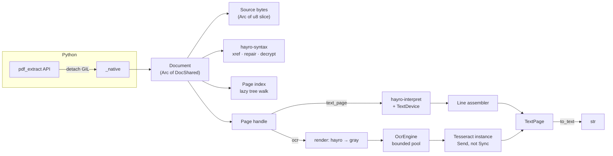

# pdf-extract: design specification

**Status:** draft for review · **Date:** 2026-09-25

A Rust library with a Python binding that replaces the PyMuPDF functionality
its first consumer uses: open a PDF, count its pages, read each page's text layer, and
OCR pages that have too little text. It is safe to call from many threads at
once.

The contract being replaced was described in a survey of the first consumer's
PyMuPDF usage, which is kept in the internal archive and is not published. This
document cites it as **internal survey §n**, meaning section *n* of that survey.

---

## Contents

0. [Summary and key decisions](#0-summary-and-key-decisions)
1. [Scope](#1-scope)
2. [Requirements](#2-requirements)
3. [Choosing the foundation](#3-choosing-the-foundation)
4. [Architecture](#4-architecture)
5. [Documents and pages](#5-documents-and-pages)
6. [Text extraction](#6-text-extraction)
7. [OCR](#7-ocr)
8. [Concurrency model](#8-concurrency-model)
9. [Error model](#9-error-model)
10. [Resource limits](#10-resource-limits)
11. [Rust API](#11-rust-api)
12. [Python API](#12-python-api)
13. [Verification](#13-verification)
14. [Build, packaging and license compliance](#14-build-packaging-and-license-compliance)
15. [Migrating from PyMuPDF](#15-migrating-from-pymupdf)
16. [Delivery plan](#16-delivery-plan)
17. [Risks and open questions](#17-risks-and-open-questions)
- [Appendix A: Traceability to the internal survey](#appendix-a-traceability-to-the-internal-survey)
- [Appendix B: Probe measurements](#appendix-b-probe-measurements)

---

## 0. Summary and key decisions

| # | Decision | Why |
|---|---|---|
| D1 | The core is **pure Rust**, built on the **hayro** crates (`hayro-syntax`, `hayro-interpret`, `hayro`), which are Apache-2.0 OR MIT. | hayro provides the parser, xref repair, RC4/AES decryption, font handling, a rasteriser and JBIG2/JPEG 2000/CCITT decoders, all without copyleft code. MuPDF (AGPL) and Poppler (GPL) are excluded by license. PDFium is excluded because its calls must be serialised process-wide (§3). |
| D2 | We keep a **patched fork of hayro** until our changes are merged upstream (§3.3). | Probing showed that `hayro-syntax` 0.7.2 builds an object for every page when it opens a file: 8.9 s and 1.49 GB for a 1M-page, 87 MB PDF. That defeats the page-count guard. |
| D3 | We write **our own text layer**. A structured model (page → blocks → lines → chars) is filled by a hayro `Device`, and a deterministic line assembler rebuilds PyMuPDF's `'text'` output shape. | The downstream paragraph heuristics depend on that exact shape (internal survey §2.5). |
| D4 | **Tesseract 5**, built from vendored, checksum-pinned sources and statically linked. OCR engine instances live in a **bounded pool**. | This is what PyMuPDF does today (internal survey §2.6), minus the risks: no subprocess discovery, a pool size you can set, and errors classified by type. |
| D5 | Two OCR error classes: **host-level** failures raise `OcrUnavailableError`, a `RuntimeError`. **Page-level** failures raise `OcrPageError`, which is not a `RuntimeError`. A missing language file is a host-level failure. | This keeps the tri-state contract in internal survey §3 req. 4 and fixes finding internal survey §6.2. |
| D6 | Every public type is `Send + Sync`. The GIL is released for all real work. **Free-threaded CPython** is supported. One `Document` can be shared between threads. | Multithreading is a hard requirement (internal survey §2.9). |
| D7 | `page_count` is **honest and bounded**. It comes from a lazy walk of the page tree that never builds page objects, and `open(max_pages=N)` stops walking once N is exceeded. | A guard that trusts `/Count` can be lied to. We measured PyMuPDF doing exactly that (Appendix B). |
| D8 | The Python API is **new** and does not imitate `fitz`. Default behaviour matches PyMuPDF. Improvements are opt-in or listed as behaviour changes (§15.2). | The brief allows it, and it removes a deprecated import (internal survey §6.5). |
| D9 | Parity is measured **black-box** against PyMuPDF 1.28.2 on a corpus. **No MuPDF source is read or ported.** | The reason for replacing PyMuPDF is its license. The replacement must not bring AGPL code back in. |

Working names: Python distribution `pdf-extract`, import `pdf_extract`; Rust
crates `pdf-extract-*`. The crates.io name `pdf-extract` belongs to an
unrelated crate. The PyPI name `pdf-extract` was free on 2026-09-25 (§17).

---

## 1. Scope

### 1.1 In scope

Everything in internal survey §3, restated as a new API:

- Open a PDF from a filesystem path, or from bytes.
- Detect the file type from its content.
- Raise on every failure.
- Report a cheap page count.
- Iterate over pages in document order.
- Extract a page's text as one string, in PyMuPDF's `'text'` shape.
- OCR a whole page with Tesseract and read the result in the same shape.
- Release all resources deterministically, through a context manager or `close()`.
- Support concurrent use from many threads.
- A **test kit** that replaces the fixture-building calls in internal survey §5: create a
  document, add a page, place text at an exact point, save.

### 1.2 Out of scope (v1)

Everything in internal survey §4:

- Rendering to images as a public API. Rendering exists only inside OCR.
- Image extraction, metadata, outline, annotations as objects, links, forms,
  search, page labels and fonts as an API.
- Writing or modifying PDFs, except in the test kit.
- Formats other than PDF (XPS, EPUB, CBZ, images).
- Output modes other than plain text, such as `dict`, `blocks`, `words` or
  HTML. The internal model can support these later (§6.1).
- Password authentication. The parser already supports it, so adding
  `password=` to `open()` later is trivial. v1 leaves it out to keep the
  surface small.

### 1.3 Terms

| Term | Meaning |
|---|---|
| **Compat profile** | The default output settings, which reproduce PyMuPDF 1.28.2's `get_text('text')` shape. |
| **Oracle** | PyMuPDF 1.28.2 run as a black box in a separate tool environment to produce expected outputs (§13.1). It is never a dependency of this library. |
| **Visible box** | The page's CropBox clipped to its MediaBox. |
| **Host-level OCR failure** | This process cannot OCR any page with the current configuration. |
| **Page-level OCR failure** | OCR failed for one page; the next page may succeed. |

---

## 2. Requirements

Requirement IDs are cited throughout the document. Appendix A maps them back to
the internal survey.

### 2.1 Functional

| ID | Requirement |
|---|---|
| F1 | `open(path)` opens a PDF from a path. `open_bytes(data)` opens one from memory. |
| F2 | The file type is detected from content only. The file name and extension are ignored. A `%PDF-` header anywhere in the first 1024 bytes marks a PDF. Anything else raises `NotAPdfError`. |
| F3 | Every failure to open raises an exception from the library's hierarchy (§9). Nothing fails silently or by return value. This covers: missing file, zero-byte file, `%PDF-` followed by garbage, plain text, an unrepairable structure, a user password, an unsupported security handler, a file over the size limit, and a document over `max_pages`. |
| F4 | Encrypted documents whose user password is empty (owner-password-only) open and extract transparently. RC4 40–128, AES-128 and AES-256 (R5/R6) are supported. A document that needs a user password raises `PasswordRequiredError` **at open**. |
| F5 | `page_count` is O(1) once the document is open. Open finds it by walking the page tree **without** reading content streams or resources, and without building page objects. Iteration yields exactly `page_count` pages. `open(..., max_pages=N)` raises `TooManyPagesError` as soon as it finds page N+1, so the cost is O(N) no matter how many pages the file claims. |
| F6 | `for page in doc` yields pages in document order. `doc[i]` gives random access. A `Page` is a lightweight handle: an index plus a reference to the document. |
| F7 | `page.text()` returns the page's text layer in the **compat shape**: every line ends in `'\n'`, blocks are separated by a single `'\n'` (no blank line), lines follow content-stream order, ligatures and whitespace are kept, text outside the visible box is dropped, and an empty page gives `''`. See §6. |
| F8 | `page.ocr(engine)` renders the whole page, runs OCR and returns a `TextPage` whose `text()` has the same shape as F7. The resolution is configurable. The default is **300 dpi**; PyMuPDF used 72 dpi (internal survey §6.1), and that value is available for parity runs. |
| F9 | A `TextPage` is immutable and can be read many times. `page.text_page()` builds one from the text layer, which is what tests use to fake an OCR result (internal survey §5). |
| F10 | The test kit can create a document, add a page of a given size, place a line of text at an exact point in a given font size and render mode, and save to a path or to bytes. |
| F11 | The library prints nothing to stdout or stderr, including Tesseract's diagnostics. Non-fatal problems are collected as structured `warnings` on `Document` and `TextPage`. |

### 2.2 Concurrency

| ID | Requirement |
|---|---|
| C1 | Different `Document`s used on different threads run fully in parallel. Nothing on the text path holds a process-wide lock. |
| C2 | One `Document` may be used from several threads at once, for example extracting different pages. Results are identical to sequential use. |
| C3 | The Python binding releases the GIL for every operation that does more than constant work. The module supports free-threaded CPython (3.13t and later) without re-enabling the GIL. |
| C4 | Calling `close()` while other threads are using the document is safe. Operations already running finish normally. Later operations raise `DocumentClosedError`. Memory is freed when the last running operation finishes. |
| C5 | OCR concurrency is bounded by a pool size you can set. OCR never starts threads the caller did not ask for: Tesseract is built without OpenMP and the rasteriser is single-threaded for each page. |
| C6 | Output is deterministic. It depends only on the input bytes, the options, the library version and the language-data file, never on thread count or scheduling. |
| C7 | Importing the module does no work and starts no threads. State created lazily, such as the default OCR engine, notices a `fork()` (for example gunicorn with `preload_app`) and is rebuilt in the child. |

### 2.3 Robustness (hostile input)

Uploads are untrusted. The first consumer accepts files up to 100 MB.

| ID | Requirement |
|---|---|
| R1 | No input may crash the process through a segfault, abort, stack overflow or unbounded memory. Rust panics are caught at the Python boundary and raised as `InternalError`; they must never escape as `pyo3.PanicException`, which derives from `BaseException`. Recursion is bounded, and CI tests the library on 512 KiB thread stacks. |
| R2 | Every quantity that can grow is capped by a limit that has a documented default and can be overridden (§10). |
| R3 | Parsing is lenient. Every corpus file the oracle opens must open, apart from documented exceptions. Broken xref tables are repaired, and damaged page content yields partial text plus a warning, not an exception. |
| R4 | Each page's interpretation has a work budget, and each OCR call has a deadline. Exceeding either raises a page-level error. |

### 2.4 Performance

These are targets. Phase 0 (§16) confirms them on the benchmark corpus.

| ID | Target |
|---|---|
| P1 | Open plus `page_count`: 100k-page file ≤ 100 ms; 1M-page file (87 MB) ≤ 1.5 s and ≤ 150 MB above the file size. With `max_pages=N`, time is O(N) plus the xref parse. |
| P2 | Single-threaded text extraction is no slower than 1.5× PyMuPDF on the corpus median. |
| P3 | Throughput with 4 threads on 4 cores is at least 3.5× single-threaded, for both separate documents and a shared one. |
| P4 | Peak memory per open document ≤ file size + 64 MB, excluding OCR. OCR adds at most one rendered page and one Tesseract working set per pool instance. |

### 2.5 Output parity

| ID | Requirement |
|---|---|
| K1 | Compat-profile text agrees with the oracle closely enough to pass the gates in §13.2. The most important gate is agreement on the caller's one decision, `len(text.strip()) >= 50`. |
| K2 | Every behaviour difference from the oracle is either configurable back to parity or listed in §15.2. |

### 2.6 Licensing

| ID | Requirement |
|---|---|
| L1 | The shipped dependency graph, Rust and C/C++, contains only permissive licenses: MIT, Apache-2.0, BSD-2/3, ISC, Zlib, Unicode-3.0 or similar. **AGPL, GPL and LGPL are banned**, including transitively. CI enforces this (§14.3). |
| L2 | No MuPDF or PyMuPDF code is read, copied or translated into this project. Behaviour is matched only by black-box observation (D9). |

---

## 3. Choosing the foundation

### 3.1 Options considered

| Option | License | Verdict |
|---|---|---|
| MuPDF / PyMuPDF | AGPL-3.0 | **Excluded.** It is what we are replacing. |
| Poppler, Xpdf | GPL | **Excluded** (L1). |
| jbig2dec (a common JBIG2 decoder) | AGPL-3.0 | **Excluded** (L1). Any choice needs a permissive JBIG2 decoder, because scanned documents often use JBIG2. |
| PDFium via `pdfium-render` | BSD-3 / Apache-2.0 OR MIT | **Rejected.** PDFium is mature, but it is not thread-safe even across different documents. `pdfium-render` makes it safe by putting every call behind one global mutex, which serialises all PDF work in the process. That fails C1, which is the requirement that matters most. It also needs a prebuilt C++ binary for each platform. |
| `lopdf` | MIT | **Rejected** as the foundation. It loads the whole document eagerly, its repair is limited, and it has no content interpreter, font handling or rasteriser. |
| Write our own parser | n/a | **Rejected.** Handling real-world broken PDFs robustly takes years. |
| **hayro** (`hayro-syntax`, `-interpret`, `hayro`, `-jbig2`, `-jpeg2000`, `-ccitt`, `-cmap`) | Apache-2.0 OR MIT | **Selected, on conditions (§3.3).** Pure Rust. The interpreter crate forbids `unsafe`, and the parser has very little. It repairs broken xrefs and decrypts RC4 and AES (V2/AESV2/AESV3). It maps glyphs to Unicode through ToUnicode, then the Adobe Glyph List, then `uniXXXX` names. It includes a CPU rasteriser and permissive JBIG2, JPEG 2000 and CCITT decoders. Its test suite covers 1,400+ PDFs, mostly from the pdf.js and PDFBox regression corpora. |

### 3.2 What probing hayro 0.7 showed

These results come from probes run while writing this spec. Appendix B has the
numbers.

1. **Thread safety.** `hayro_syntax::Pdf` and `hayro_syntax::page::Page` are
   `Send + Sync`, which a compile-time assertion confirmed.
   `hayro_interpret::Context` is **not**, because its font cache is an
   `Rc<RefCell<…>>`. So interpreter contexts must be created per call or per
   worker, not shared (§8.3).
2. **Page tree.** `Pdf::new` builds every `Page` object while it opens the
   file. That took 0.17 s and 149 MB for 100k pages, and 8.9 s and 1.49 GB
   for 1M pages. PyMuPDF took 6 ms and 64 ms respectively, because it trusts
   `/Count`. The cost is not linear, and an 87 MB file fits under the upload
   limit, so this is a denial-of-service vector. **It must be fixed (H1).**
3. **Cycles.** A `/Kids` array that contains its own parent is handled without
   a stack overflow. A leaf listed twice is counted twice.
4. **Encryption.** A file that needs a user password fails in `Pdf::new` with
   `DecryptionError::PasswordProtected`, which fits F4. Owner-only files open.
5. **Unicode.** `Glyph::as_unicode()` has good fallbacks for simple fonts.
   For CID fonts it uses **only** ToUnicode, and hayro calls it "somewhat
   experimental". The glyph's raw character code is `pub(crate)`, so the
   compat "unmapped → CID" rule (§6.2) cannot be built on the public API
   (H5, H6).
6. **Hooks.** The `Device` gets `begin_marked_content(tag, mcid)` but not the
   property dictionary, so `/ActualText` is not visible (H4). There is no
   cancellation or work-budget hook (H3). The limit on nested Form XObjects,
   patterns and Type 3 fonts is 50.
7. **Licenses.** `hayro`, `hayro-interpret` and `hayro-syntax` (feature
   `unsafe`) plus PyO3 resolve to 85 third-party crates. Every one is MIT,
   Apache-2.0, BSD-3, Zlib, Unicode-3.0 or Unlicense, or an OR-combination of
   these.

### 3.3 Required changes to hayro

We send each change upstream. Until it is merged, we carry it in a fork that
the workspace uses through `[patch.crates-io]`. The licenses allow this.
Versions are pinned exactly (`=0.7.x`), because 0.x releases break APIs.

| ID | Change | Needed for | Blocking? |
|---|---|---|---|
| H1 | Build the page list lazily. `Pdf::new` must not walk or build pages. Expose enough object-level access (resolve a reference, read a node's dictionary, build a `Page` from a dictionary plus inherited attributes) for our page index (§5.4). | F5, P1, R2 | **Yes** |
| H2 | Cap the decoded size of each stream (flate, LZW and image bombs) and of the whole document. | R2 | **Yes** |
| H3 | A cooperative budget or cancellation callback in `InterpreterSettings`, checked every *k* operators and on entry to each XObject, pattern or Type 3 glyph. | R4 | **Yes** |
| H4 | Pass marked-content property dictionaries to `Device` (for `/ActualText`). | K1, if compat point KP9 shows the oracle uses ActualText | Conditional |
| H5 | Expose `char_code()` and a reference to the font dictionary on glyphs. | §6.2 unmapped policy and CID fallbacks | **Yes** |
| H6 | More Unicode fallbacks for CID fonts: predefined `*-UCS2` CMaps for Adobe-GB1/CNS1/Japan1/Korea1, and a reverse of the embedded TrueType cmap for Identity-H. Upstream is preferred; our layer can do it instead if H5 lands. | K1 on CJK or oddly built fonts | No |
| H7 | Optional: a font cache that can be shared between threads (`Arc` plus a lock or `OnceLock` in place of `Rc<RefCell>`). | P2 for shared documents | No |

If upstream declines a blocking change, the fork becomes permanent. It is then
rebased on each hayro release we adopt, and the corpus gates (§13) run on
every rebase.

---

## 4. Architecture

### 4.1 Crates

```
pdf-extract/                      (Cargo workspace + maturin project)
├── crates/
│   ├── core/          pdf-extract-core      Document, Page, TextPage, page index,
│   │                                         text device, line assembly, limits, errors
│   ├── render/        pdf-extract-render    page → 8-bit grayscale bitmap (via hayro)
│   ├── ocr/           pdf-extract-ocr       OcrBackend trait, OcrEngine + pool,
│   │                                         tessdata resolution, GrayImage
│   ├── tesseract-sys/ pdf-extract-tesseract-sys
│   │                                         vendored Tesseract + Leptonica, C++ shim, FFI
│   ├── python/        pdf-extract-python    PyO3 module `pdf_extract._native`
│   └── testkit/       pdf-extract-testkit   minimal PDF writer (fixtures), oracle-diff
│                                             harness; dev-only, also exposed to Python
├── python/pdf_extract/                       pure-Python package: __init__, errors, testing,
│                                             *.pyi stubs, py.typed
├── fuzz/                                     cargo-fuzz targets
├── tools/oracle/                             PyMuPDF oracle runner (separate venv; never shipped)
└── vendor/                                   pinned third-party sources + checksums
```

Dependencies only point down the list: `python` → `core` → {`render`, `ocr`}
→ `tesseract-sys`. `render` and `core` depend on hayro. Only `tesseract-sys`
and `python` contain hand-written `unsafe`. Every other crate has
`#![forbid(unsafe_code)]`.

### 4.2 Data flow



### 4.3 Main third-party dependencies

| Component | Crate or library | License |
|---|---|---|
| Parse, decrypt, filters | `hayro-syntax` (feature `unsafe`: `flate2`, SIMD, `memchr`) | Apache-2.0 OR MIT |
| Content interpretation, fonts, Unicode | `hayro-interpret`, `hayro-cmap` | Apache-2.0 OR MIT |
| Rasterisation | `hayro` (on `vello_cpu`) | Apache-2.0 OR MIT |
| Image codecs | `hayro-jbig2`, `hayro-jpeg2000`, `hayro-ccitt`, `zune-jpeg` | Apache-2.0 OR MIT (zune: MIT OR Apache-2.0 OR Zlib) |
| Font tables, for our fallbacks | `skrifa` / `read-fonts` | Apache-2.0 OR MIT |
| OCR engine | Tesseract 5.5.x, vendored | Apache-2.0 |
| Image library under Tesseract | Leptonica 1.8x, vendored, built without codecs | BSD-2-Clause |
| Python binding | PyO3 ≥ 0.29 | Apache-2.0 OR MIT |
| Errors | `thiserror` | MIT OR Apache-2.0 |

We deliberately do **not** use `tesseract-rs` (MIT). Its `build.rs` downloads
Tesseract and Leptonica source from GitHub at build time, so builds are not
hermetic. It also declares `unsafe impl Sync` on Tesseract iterator handles,
which contradicts our model where an instance is `Send` but not `Sync`. Our
`-sys` crate is small. It exposes the roughly 20 C API functions we need, plus
a C++ shim that turns C++ exceptions into error codes (§7.6).

---

## 5. Documents and pages

### 5.1 Source

`open(path)` reads the whole file into one `Arc<[u8]>` and closes the file
descriptor before returning. The limit is `max_file_size`, default 512 MiB,
checked with `fstat` before reading. The reasons:

- The descriptor is released at once. `close()` then only has to free memory
  (internal survey §2.3).
- A memory map would raise `SIGBUS` and kill the whole gunicorn worker if
  another process truncated the file. Reading into memory cannot fail that
  way.
- hayro takes its input as `Arc<dyn AsRef<[u8]> + Send + Sync>`, so the buffer
  can be shared without copying.

The cost is memory: four concurrent 100 MB uploads hold 400 MB. An opt-in
`Source::Mmap`, behind the Rust feature `mmap` and the Python option
`open(..., mmap=True)`, is available for callers who can guarantee the file is
never truncated while open. Its `SIGBUS` caveat is documented.

`open_bytes(data)` copies the Python buffer once, so the document never depends
on a Python object after `open_bytes` returns.

### 5.2 Detecting the file type

1. A zero-length file raises `EmptyFileError`.
2. If `%PDF-` does not appear in the first 1024 bytes, raise `NotAPdfError`.
   Plain text named `.pdf` fails here.
3. Otherwise the file is handed to the parser. If neither normal parsing nor
   repair produces a usable trailer and catalogue, raise `CorruptDocumentError`.
   `%PDF-` followed by garbage fails here.

Other formats are never guessed. There is no extension-based dispatch.

### 5.3 Cross-reference table and repair

Delegated to `hayro-syntax`. It handles classic tables, xref streams, hybrid
files, `/Prev` chains (capped at 256), object streams and a full-file repair
scan. When repair was needed, the document gets the warning
`"xref: repaired"`. The number of objects is capped by `max_objects`.

### 5.4 Page index (H1)

Open builds the page index eagerly, but the index is small and nothing in it
touches page content:

```
walk(root = catalog./Pages):
    stack ← [(root, inherited = ∅, depth = 0)]; seen ← {}
    while stack not empty:
        (ref, inh, depth) ← pop
        if ref ∈ seen: warn("page tree: node revisited"); continue     ← cycles and duplicates
        seen ∪= {ref}
        if depth > max_page_tree_depth: warn(...); continue
        dict ← resolve(ref)                       ← parses this one dictionary only
        inh' ← inh ⊕ {MediaBox, CropBox, Rotate, Resources} found in dict (stored as a
               reference into a per-node table, not copied per leaf)
        if dict is a Pages node (has /Kids array):
            push kids in reverse order with (inh', depth + 1)
        else:                                      ← /Type Page, missing or wrong: treat as leaf
            leaves.push(PageRef { obj: ref, inherit: inh'.id })
            if max_pages set and leaves.len() > max_pages:
                raise TooManyPagesError(limit = max_pages, at_least = leaves.len())
```

- **Each leaf costs 16 bytes.** A 1M-page index is 16 MB.
- **`/Count` is ignored**, except as a capacity hint. It cannot shrink or grow
  the result. We measured PyMuPDF trusting it: a `/Count 5` on a 100k-page
  tree gave `page_count == 5`, and the other 99,995 pages were silently
  dropped (Appendix B). Our count is what iteration will actually yield.
- **A node reached twice is skipped**, whether through a cycle or a duplicate
  leaf. This differs from hayro 0.7, which counts a duplicate leaf twice, and
  is recorded as compat point KP10.
- **Fallback.** If `/Root /Pages` is missing or yields nothing, scan all
  objects for `/Type /Page` in object-number order. This is hayro's
  `new_brute_force`. The scan is bounded by `max_pages` as well.
- A `Page` is built from `(PageRef, inherited attributes)` only when an
  operation needs it, and it is not cached.

### 5.5 Encryption

| Document | Behaviour |
|---|---|
| Not encrypted | Normal. |
| Standard handler, empty user password: RC4 V1/V2, AESV2, AESV3 (R2–R6) | Decrypted transparently. `Document.is_encrypted` is `True`. |
| Needs a user password | `PasswordRequiredError` at open (F4). |
| Missing `/ID`, malformed `/Encrypt`, or a public-key or unknown handler | `UnsupportedEncryptionError` at open. |

Permission bits (`/P`) are ignored. Text extraction is always allowed, which
matches the owner-only behaviour in internal survey §2.2.

### 5.6 Closing

Described in §8.2. `Document.__exit__` always calls `close()` and never
suppresses the exception. Dropping the last reference, through garbage
collection or `del`, also frees everything. A `Page` or `TextPage` that
outlives `close()` stays a valid Python object. `Page` methods raise
`DocumentClosedError`, and a `TextPage` stays fully readable because it owns
its data.

---

## 6. Text extraction

### 6.1 Pipeline

```
Page ──hayro-interpret──▶ TextDevice ──▶ CharRecord stream (content-stream order)
     ──filter (§6.3)──▶ LineAssembler (§6.4) ──▶ blocks[lines[chars]] = TextPage
     ──serialise (§6.5)──▶ String
```

`TextDevice` implements `hayro_interpret::Device`. It ignores paths, images,
clips and transparency groups. For each `draw_glyph` call it records:

```rust
struct CharRecord {
    text: SmallString,        // 1+ code points (ToUnicode entries can be multi-char)
    origin: Point,            // baseline start, page space (after CTM, page rotation applied)
    dir: Vec2,                // unit baseline direction, page space
    size: f32,                // effective font size = |glyph_transform| scale along the line normal
    advance: f32,             // along `dir`, page units (from /Widths or /W via advance_width())
    font: FontKey,            // font_cache_key()
    invisible: bool,          // GlyphDrawMode::Invisible (Tr 3 or 7)
    seq: u32,                 // emission order
}
```

The structured model (`Block { lines, bbox }`, `Line { chars, bbox, dir }`)
is kept internally. That lets later versions add `words`, `blocks` or JSON
output without changing the extractor. v1 exposes only the serialised text.

What is interpreted:

- The page's content streams, recursing into Form XObjects.
- **Annotation appearance streams (`/AP /N`)** for annotations that are not
  hidden. The oracle includes their text: a FreeText annotation's text shows
  up in `get_text('text')` (Appendix B, KP8).
- **Invisible text (render mode 3).** The oracle includes it. It is the text
  layer of every PDF that was OCR'd earlier, so it must be kept.
- Type 3 glyph procedures are run for rendering only. Their inner glyphs are
  not emitted as text; the Type 3 glyph itself is.

### 6.2 From glyph to Unicode

For each glyph, take the first of these that gives a result:

1. The font's **ToUnicode** CMap. Entries with several code points are kept
   whole.
2. **Simple fonts** (Type 1, TrueType, CFF, Type 3): the glyph name from
   `/Encoding` (base encoding plus `/Differences`), looked up in the Adobe
   Glyph List or read as a `uniXXXX` / `uXXXX[XX]` name. For embedded fonts
   with no names, use the font's own `post` table or CFF charset names. This
   is hayro's chain, extended to Type 3 `/Differences`.
3. **CID fonts** with a predefined ordering (Adobe-GB1/CNS1/Japan1/Korea1):
   the matching `*-UCS2` CMap (H6).
4. **Identity-H/V with an embedded TrueType font**: reverse the font's
   `cmap` subtable, (3,1) then (3,10) then (0,x), from glyph id to Unicode
   (H6).
5. Otherwise the glyph is **unmapped**. The `unmapped` option decides what
   happens:
   - `"cid"` (compat default): emit the raw character code as a code point,
     as PyMuPDF does (internal survey §2.5). Exception: codes that would produce NUL, C0
     controls other than TAB/LF/CR, surrogates (U+D800–DFFF), U+FFFE/U+FFFF
     or anything above U+10FFFF become **U+FFFD**. Rust strings cannot hold
     surrogates, and NUL cannot be stored in PostgreSQL `text`. This is a
     deliberate difference from the oracle (§15.2).
   - `"replacement"`: always U+FFFD.
   - `"skip"`: emit nothing. The glyph's advance still counts for spacing.

No normalisation is applied:

- Ligature code points such as U+FB01 stay as they are, as with PyMuPDF's
  preserve-ligatures flag.
- Tabs, no-break spaces and other whitespace are kept as they are.
- NFC/NFKD folding is left to the caller. The first consumer does it only on the copy
  used for embeddings.

### 6.3 Filtering

- **Clip.** A glyph is dropped if its approximate box lies entirely outside
  the visible box. The box spans the origin to origin + advance, with
  −0.2 em to +0.8 em across the baseline. The oracle drops text placed below
  the MediaBox (Appendix B, KP7). Glyphs partly inside are kept.
- **Optional content.** Glyphs in hidden optional content groups are dropped.
  hayro already tracks OCG state. Whether this matches the oracle is compat
  point KP11.
- **Zero-size glyphs** are kept if they have a Unicode value, because some
  generators use them for hidden text.

### 6.4 Assembling lines

The algorithm works in **content-stream order**. It compares each character
only with the current line and never searches earlier lines. The oracle's
`sort=False` behaves the same way (internal survey §2.5). All thresholds are in units of
`em = max(c.size, L.size)` and live in a `LayoutParams` struct. Their compat
defaults are **tuned against the oracle** (§13), not taken from MuPDF source.

```
for c in chars:
    if L is none:                                   start line
    elif angle(c.dir, L.dir) > 2°:                  start line          (rotation / vertical text)
    else:
        δ     = c.origin − L.pen                    (L.pen = end of last char's advance)
        along = δ · L.dir
        perp  = |δ × L.dir|
        if perp > PERP_BREAK · em:                  start line          (next line, or big rise)
        elif along < −BACK_BREAK · em:              start line          (moved back: new line or overprint)
        elif along > GAP_BREAK · em:                start line          (wide same-baseline gap)
        else:
            if along > SPACE_GAP · em
               and neither L's last char nor c is whitespace:
                append synthetic U+0020 to L
            append c to L
```

Starting points for the compat defaults, bracketed from the oracle probes in
Appendix B (Helvetica, 11 pt):

| Parameter | Observed bracket | Initial value |
|---|---|---|
| `SPACE_GAP` | a gap of ≤ 1 pt gave no space; ≥ 2 pt gave a space → (0.09, 0.18] em | 0.15 em |
| `GAP_BREAK` | 8 pt stayed on the line; 12 pt started a new line → (0.73, 1.09] em | 1.0 em |
| `PERP_BREAK` | a 7 pt superscript raised 4 pt joined the line (`"Basesup"`) → > 0.36 em | 0.5 em |
| `BACK_BREAK` | not probed yet | 0.5 em (KP3) |

**Blocks.** A line starts a new block when any of these holds: the direction
changes; the perpendicular distance from the previous line exceeds
`BLOCK_GAP` (1.5 line heights); the line starts left of the previous block by
more than 2 em; or a new Form XObject or annotation begins. In the compat
profile block boundaries **do not change the output**, because blocks and
lines are both separated by a single `'\n'`. They matter only for the
`"blank_line"` separator.

**Fake bold.** Some generators draw the same glyph twice, a fraction of a
point apart, to fake bold. This shows up as `along < 0` by less than
`BACK_BREAK`. Compat point KP4 decides whether the oracle removes the
duplicates. If it does, we remove a glyph whose text and font match the
previous glyph and whose origin is within 0.1 em of it.

### 6.5 Serialisation

```
to_text(block_separator):
    out = ""
    for (i, block) in blocks:
        if i > 0 and block_separator == "blank_line": out += "\n"
        for line in block.lines: out += line.text + "\n"
    return out
```

| Property | Compat (`block_separator="newline"`, default) | `"blank_line"` |
|---|---|---|
| Line terminator | `'\n'` after every line, including the last | same |
| Between blocks | nothing extra, so a single `'\n'` | one empty line |
| Empty page | `''` | `''` |
| Trailing spaces within a line | kept as emitted (KP5) | same |

`"blank_line"` is the improvement internal survey §2.5 anticipates. It changes which branch
the consumer's paragraph splitter takes, so it is opt-in (§15.2).

### 6.6 Compat points

These are behaviours of the oracle that the spec does not fix by assertion.
Each is **pinned by a fixture and an oracle-generated expectation in
Phase 0**, and the table records how it was resolved.

| ID | Question | Status |
|---|---|---|
| KP1 | Space-insertion threshold | Bracketed (§6.4); needs tuning |
| KP2 | Same-baseline gap threshold for a new line | Bracketed (§6.4); needs tuning |
| KP3 | Backward movement: new line or overprint? | Open |
| KP4 | Are duplicated fake-bold glyphs removed? | Open |
| KP5 | Are spaces at the end of a line kept? | Open |
| KP6 | Output for unmapped glyphs in simple and CID fonts; exact code-point behaviour | Open (§6.2) |
| KP7 | Clipping box: MediaBox or CropBox? Fully-outside or centre-point test? | Partly resolved: text below the MediaBox is dropped |
| KP8 | Annotation appearance text included? | **Resolved: yes** (FreeText) |
| KP9 | `/ActualText` honoured? | Open (H4 depends on this) |
| KP10 | Page-tree duplicates and cycles | Deliberate difference: honest count (§5.4) |
| KP11 | Hidden optional content | Open |
| KP12 | Vertical writing mode (`WMode 1`) line assembly | Open, low priority |
| KP13 | Invisible text (Tr 3) included? | **Resolved: yes** |

---

## 7. OCR

### 7.1 Flow

```
page.ocr(engine, dpi = engine.dpi)
  1. dpi' = min(dpi, the largest dpi keeping width × height ≤ max_render_pixels)    (§10)
  2. img  = render.gray(page, dpi')      ← hayro; white background; annotations drawn;
                                           8-bit luminance from the RGBA pixmap
  3. out  = engine.recognize(img, dpi')  ← pooled Tesseract; deadline = page_timeout
  4. TextPage { source: Ocr, dpi: dpi', blocks: from out (block → line → word) }
```

- **Whole page only.** This matches `full=True` in internal survey §2.6. Merging OCR output
  with an existing text layer is the caller's job.
- **Lines come from Tesseract's layout analysis.** Tesseract's `RIL_TEXTLINE`
  lines become `Line`s and `RIL_BLOCK` blocks become `Block`s, with words
  joined by single spaces. We do not re-run our line assembler over OCR
  output. PyMuPDF's OCR text cannot be matched byte for byte anyway: the
  rasteriser, Tesseract build and resolution all differ. So OCR parity is
  measured by error rates (§13.4), not string equality.
- Coordinates are scaled from pixels back to page points, so the structured
  model has the same meaning for both sources.
- **Resolution.** The default is **300 dpi**. At 72 dpi PyMuPDF garbled case
  names and reporter citations (internal survey §6.1). An A4 page at 300 dpi is 8.7 MP, or
  8.7 MB as grayscale. `OcrEngine(dpi=72)` restores parity for parity runs.

### 7.2 OcrEngine

```rust
pub struct OcrConfig {
    pub tessdata: Option<PathBuf>,     // explicit; else resolved per §7.3
    pub languages: Vec<String>,        // default ["eng"]; joined as "eng+deu" for Tesseract
    pub dpi: u32,                      // default 300
    pub max_instances: usize,          // default min(available_parallelism(), 4)
    pub page_timeout: Duration,        // default 60 s (Tesseract ETEXT_DESC deadline)
    pub psm: PageSegMode,              // default Auto (3)
    pub oem: EngineMode,               // default LstmOnly
    pub max_render_pixels: u64,        // default 40_000_000
}
```

**Construction validates the setup and fails fast:**

1. Resolve the tessdata directory (§7.3).
2. Check that `<dir>/<lang>.traineddata` exists and is readable for every
   language.
3. Create **one** Tesseract instance and call `Init`. Any failure raises
   `OcrUnavailableError`, with a `reason` of `no_tessdata`,
   `language_data_missing`, `init_failed` or `engine_not_built`, a message
   naming the paths searched, and the attributes `tessdata` and `languages`.

So "this host cannot OCR" is known **once, before any page**. Today it is
discovered on every sparse page (internal survey §2.7, internal survey §6.2).

**The pool:**

- `Mutex<Vec<TessInstance>>` plus a `Condvar`. Instances are created lazily
  up to `max_instances`. A caller waits when all are busy.
- `TessInstance` is `Send` but **not `Sync`**. It is owned by the pool while
  idle and by one thread while in use, and it is never exposed.
- After each page the instance is `Clear()`ed and returned. An instance that
  returned an error is **dropped, not returned**, since its internal state is
  unknown. A replacement is created lazily.
- If creating an extra instance later fails, for example because the
  language file was deleted, that is a host-level error (`OcrUnavailableError`).
- **Fork safety.** The pool records its creator's PID. In a forked child it
  is abandoned: the instances are leaked rather than freed, because another
  thread in the parent may have owned them at fork time. A fresh pool is then
  built.
- Each instance holds its own copy of the model: tens of MB for
  `eng.traineddata`. Callers size `max_instances` against their memory budget.

**`default_ocr_engine()`** is a lazily created, per-process engine built from
the environment. If construction fails, the error is stored and raised again
on each call without retrying, so it stays cheap. The environment is read once
per process.

### 7.3 Finding the language data

No subprocesses, no shell and no `whereis` (compare internal survey §2.7 steps 3–4):

1. `OcrConfig.tessdata`, if given.
2. `$TESSDATA_PREFIX`. Tesseract 3 and 5 disagree about whether this names the
   tessdata directory or its parent, so both are accepted: `$P/<lang>.traineddata`,
   then `$P/tessdata/<lang>.traineddata`. Production already sets this variable
   (internal survey §2.7).
3. Known locations, in order: `/usr/share/tesseract-ocr/5/tessdata`,
   `/usr/share/tesseract-ocr/4.00/tessdata`, `/usr/share/tesseract/tessdata`,
   `/usr/share/tessdata`, `/usr/local/share/tessdata`,
   `/opt/homebrew/share/tessdata`.
4. If none works, `OcrUnavailableError(reason="no_tessdata", searched=[…])`.

Resolution happens once per engine.

### 7.4 Classifying OCR failures

| Situation | Raised | Python base classes | Caller's meaning (internal survey §3 req. 4) |
|---|---|---|---|
| No tessdata anywhere | `OcrUnavailableError` | `OcrError`, **`RuntimeError`** | host cannot OCR; stop for this document |
| tessdata found but `<lang>.traineddata` missing | `OcrUnavailableError` | same | same. **This fixes internal survey §6.2**, where this case was misreported per page. |
| Tesseract `Init` fails | `OcrUnavailableError` | same | same |
| Library built without the Tesseract backend | `OcrUnavailableError` | same | same |
| Rendering the page failed or exceeded a limit | `OcrPageError` | `OcrError` (not `RuntimeError`) | this page failed; try the next |
| Recognition failed or threw a C++ exception | `OcrPageError` | same | same |
| Deadline exceeded | `OcrTimeoutError` | `OcrPageError` | same |
| Recognition ran and found nothing | returns a `TextPage` whose `text()` is `''` | n/a | empty result |
| Document closed | `DocumentClosedError` | `PdfExtractError` | caller bug |

In the error hierarchy, `OcrUnavailableError` is the only class that is also a
`RuntimeError`. The rule "`RuntimeError` means host-level" therefore holds by
construction, and a unit test asserts it (§13.5).

### 7.5 OCR backends

```rust
pub trait OcrBackend: Send + Sync {
    fn recognize(&self, img: &GrayImage, req: &OcrRequest) -> Result<OcrOutput, OcrPageError>;
    fn info(&self) -> BackendInfo;          // name, version, languages, model file checksums
}
```

v1 ships only the Tesseract backend. The trait exists so that other engines
can be tried later without changing the API. One candidate is `ocrs`, a
pure-Rust engine (MIT/Apache-2.0) that would remove the C++ dependency. Its
authors still call it an early preview, it covers Latin script only, and its
`rten` runtime uses its own thread pool, which would conflict with C5 and C7.
It would need its own evaluation (§13.4) before being offered.

### 7.6 Building Tesseract, and process isolation

- Tesseract 5.5.x and Leptonica 1.8x are **vendored** under `vendor/` with
  SHA-256 checksums and built with the `cmake` crate. `build.rs` makes no
  network access. The settings are: static linking; OpenMP **off** (C5);
  Leptonica without image codecs, since we pass raw pixels through
  `TessBaseAPISetImage`, which shrinks both attack surface and dependencies;
  and no training tools.
- A roughly 200-line C++ shim wraps each call in `try { … } catch (...)` and
  returns error codes, because C++ exceptions must not unwind into Rust.
  Instance parameters are set through `Init` config variables. Tesseract's
  debug output is sent to a null sink (F11). Tesseract's process-wide
  parameters are set once, under a `Once`, and never changed.
- Feature `system-tesseract` links the distribution's `libtesseract` instead.
  It is for source builds and is not used in wheels.

**Residual risk.** Some internal Tesseract assertion failures (`ASSERT_HOST`)
end the process instead of reporting an error. PyMuPDF runs Tesseract in the
same process and has the same exposure. v1 kept OCR in-process to match.
Phase 3 added `OcrEngine(isolation="process")`: pool instances run in helper
processes (a small binary shipped in the wheel, talking over pipes), and a
crashed helper becomes `OcrPageError` and is restarted. The API stays the
same. **Amended (Phase 3, internal #53, ADR 0092):** from Python, process isolation is
the default (`OcrEngine()`, `default_ocr_engine()`, `Page.ocr()` without an
engine); Rust's `OcrConfig::default()` stays in-process. Measured overhead was
0.3 to 1.6 %, under the 10 % bar of Q1.

---

## 8. Concurrency model

### 8.1 Types

| Type | `Send` | `Sync` | Notes |
|---|---|---|---|
| `Document` | ✓ | ✓ | `Arc<DocShared>`; cloning is cheap |
| `Page` | ✓ | ✓ | `(Arc<DocShared>, index)`; no lifetimes in the public API |
| `TextPage` | ✓ | ✓ | immutable and owns its data |
| `OcrEngine` | ✓ | ✓ | `Arc` over the config and the pool |
| `TessInstance` | ✓ | ✗ | internal; owned by one thread at a time |
| `hayro_interpret::Context` | ✗ | ✗ | internal; created per operation or per worker (§8.3) |

The Python classes wrap these types directly. PyO3 requires `#[pyclass]`
types to be `Send + Sync`, so the compiler enforces this table.

### 8.2 Document state and closing

```rust
struct DocShared {
    state: RwLock<Option<Arc<Loaded>>>,   // None after close()
    page_count: usize,                    // copied out at open: readable after close
}
struct Loaded {
    source: Arc<[u8]>,
    pdf: hayro_syntax::Pdf,               // Send + Sync; internal xref cache uses RwLock
    index: PageIndex,                     // immutable after open
    fonts: FontCache,                     // sharded; see §8.3
    warnings: Vec<Warning>,
}
```

- **Each operation** takes the read lock, clones the `Arc<Loaded>` and
  releases the lock straight away. It then works on its clone with no lock
  held. A long extraction therefore never blocks `close()`, and `close()`
  never blocks one.
- **`close()`** takes the write lock and sets the state to `None`, dropping
  the document's own reference. Memory is freed when the last running
  operation drops its clone (C4). Calling `close()` twice is harmless.
- **After close**, `page_count` and `closed` still answer. Every other
  operation raises `DocumentClosedError`.
- A model-checking test (`loom`) covers this protocol and the OCR pool.

### 8.3 Interpreter contexts and font caching

A `hayro_interpret::Context` cannot move between threads (§3.2 item 1).

- A **single-page call** such as `page.text_page()` creates a fresh context.
  Fonts used on that page are parsed during the call.
- **Batch extraction** (§12.4) gives each worker a contiguous range of pages
  and one context for the whole range, so fonts are parsed once per worker.
- **Across threads**, each document has a `FontCache` of parsed font
  programs keyed by font-dictionary reference. It is sharded, uses `OnceLock`
  per entry, and has a byte budget. It becomes useful once H7 makes hayro's
  font objects shareable. Until then, per-context caching is the baseline,
  and P2 and P3 are measured against it.

### 8.4 The GIL and free-threaded Python

- Every native method that does more than constant work runs its body inside
  `py.detach(|| …)` (PyO3 ≥ 0.26 naming). This covers `open`, `open_bytes`,
  `Page.text`, `Page.text_page`, `Page.ocr`, `OcrEngine(...)`, `extract` and
  test-kit saves. Arguments are converted before detaching. The result string
  is created as a Python object after reattaching, which is one allocation.
- The module declares free-threading support. That is PyO3's default from
  0.28, and we state it explicitly. `Document.__iter__` returns an iterator
  whose position is an `AtomicUsize`, so sharing even the iterator between
  threads cannot corrupt it. Two threads sharing one iterator may each get
  different pages, as with any shared iterator.
- CI runs the whole test suite, including the stress tests, on CPython 3.14t
  with `PYTHON_GIL=0`.

### 8.5 Avoiding oversubscription

The library creates threads only:

- inside `extract(workers=n)`, as scoped threads that finish before the call
  returns; and
- in the Phase 3 OCR process-isolation option.

There is no global thread pool (no rayon global pool, no OpenMP), so nothing
is left behind to break after `fork()`.

Guidance for a caller that runs several extraction threads per web worker,
as the first consumer does (internal survey §2.9):

- Keep `workers=1` inside `extract()`, since the caller already runs documents
  in parallel.
- Set `max_instances` per process to the number of OCR pages you want running
  at once. The worst-case CPU demand is (gunicorn workers) × (extraction
  threads) for text, and (gunicorn workers) × `max_instances` for OCR.

**Containing failures on untrusted input (ADR 0093).** The fuzzing depth goal
(§16) is not a release gate, so an input that crashes the process (stack
overflow, abort, out of memory) or hangs it may still exist. A caller that
extracts uploads must contain that failure:

- Run extraction in a process whose death costs only the one job, such as a
  job-queue worker or a subprocess, never in a gunicorn worker that also
  serves requests. Extraction threads inside a gunicorn worker do not
  meet this.
- Enforce a wall-clock limit per document by killing that process. A Python
  timeout cannot interrupt a call in progress, and the library's own time
  limits (§10) are per page: `page_time_budget` per page, and OCR `page_timeout`.
- Cap retries per document and quarantine a document that keeps killing or
  timing out its worker.
- Log the document's identity when a worker dies, so the input can be
  reproduced and filed as an issue.

### 8.6 Stack use

Recursion happens only in:

- nested XObjects, patterns and Type 3 fonts, capped at 50 by hayro;
- nested PDF objects while parsing, capped by `max_object_depth`, default 256;
- CMap and function evaluation, also capped.

The page-tree walk is iterative. A CI test runs the fuzz corpus on threads
with a 512 KiB stack (R1). CPython on glibc usually gives threads 8 MiB, and
musl gives much less. The library must not depend on large stacks.

---

## 9. Error model

### 9.1 Rust

```rust
#[derive(Debug, thiserror::Error)]
pub enum OpenError {
    #[error("file not found: {0}")]              NotFound(PathBuf),
    #[error("I/O error: {0}")]                   Io(#[from] std::io::Error),
    #[error("file is empty")]                     Empty,
    #[error("file is {size} bytes; limit {limit}")] TooLarge { size: u64, limit: u64 },
    #[error("not a PDF (no %PDF- header in first 1024 bytes)")] NotPdf,
    #[error("PDF structure is damaged beyond repair: {0}")] Corrupt(String),
    #[error("document requires a password")]      PasswordRequired,
    #[error("unsupported encryption: {0}")]       UnsupportedEncryption(String),
    #[error("more than {limit} pages (found at least {at_least})")]
                                                  TooManyPages { limit: usize, at_least: usize },
    #[error("limit exceeded: {0}")]               Limit(LimitKind),
}

pub enum PageError { Closed, IndexOutOfRange { index: usize, count: usize },
                     Limit(LimitKind), Internal(String) }

pub enum OcrError  { Unavailable(OcrUnavailable), Page(OcrPageError), Closed }
pub struct OcrUnavailable { pub reason: UnavailableReason, pub tessdata: Option<PathBuf>,
                            pub languages: Vec<String>, pub searched: Vec<PathBuf>, pub detail: String }
pub enum OcrPageError { Render(String), Recognition(String), Timeout(Duration), Limit(LimitKind) }
```

Malformed content inside a page is **not** an error. Extraction continues, and
a `Warning { page, kind, detail }` is added to the `TextPage` (R3). This matches
the oracle, which extracts what it can and logs the rest.

### 9.2 Python hierarchy

The classes are defined in pure Python (`pdf_extract/errors.py`), so they can
use multiple inheritance. The native module imports them at initialisation and
raises them.

```
PdfExtractError(Exception)
├── OpenError
│   ├── DocumentNotFoundError(OpenError, FileNotFoundError)
│   ├── EmptyFileError
│   ├── NotAPdfError
│   ├── CorruptDocumentError
│   ├── PasswordRequiredError
│   ├── UnsupportedEncryptionError
│   ├── FileTooLargeError
│   └── TooManyPagesError                .limit, .at_least
├── DocumentClosedError
├── PageError
│   └── LimitExceededError               .limit_name, .value
├── OcrError
│   ├── OcrUnavailableError(OcrError, RuntimeError)   .reason, .tessdata, .languages, .searched
│   └── OcrPageError
│       └── OcrTimeoutError
└── InternalError                         a Rust panic caught at the boundary (always a bug)
```

- Any other `OSError` raised while opening becomes `OpenError`, with the
  original error as `__cause__`.
- `IndexError` is raised for an out-of-range `doc[i]`, as Python convention
  expects.
- **Panics.** Every exported function body runs inside `catch_unwind`, which
  converts a panic to `InternalError(message)`. Release builds keep
  `panic = "unwind"`, which is mandatory: under `abort` a panic would kill the
  process. `pyo3.PanicException` must never reach callers. It derives from
  `BaseException`, so `except Exception` would miss it and the worker thread
  would die. A test asserts this (§13.5).

---

## 10. Resource limits

Document limits live in `Limits`, which can be passed to `open()`. The two OCR
limits, `max_render_pixels` and `page_timeout`, live on `OcrEngine`. The
defaults are generous for real documents and cap the damage a hostile file can do.

| Limit | Default | Enforced where | Error |
|---|---|---|---|
| `max_file_size` | 512 MiB | before reading | `FileTooLargeError` |
| `max_pages` | none; the caller passes its own | page-tree walk | `TooManyPagesError` |
| `max_page_tree_depth` | 64 | page-tree walk | warning; subtree skipped |
| `max_objects` | 10,000,000 | xref | `CorruptDocumentError` |
| `max_object_depth` | 256 | object parser | object treated as `null` + warning |
| `max_stream_decoded_bytes` | 256 MiB per stream | filters (H2) | stream truncated + warning |
| `max_document_decoded_bytes` | 2 GiB per document | filters (H2) | `LimitExceededError` |
| `max_ops_per_page` | 10,000,000 | interpreter budget (H3) | `LimitExceededError` |
| `page_time_budget` | 30 s | interpreter budget (H3), checked every 4,096 operators | `LimitExceededError` |
| `max_chars_per_page` | 2,000,000 | text device | extraction stops + warning |
| `max_image_pixels` | 256 MP per decoded image | image decoders | image skipped + warning |
| `max_render_pixels` | 40 MP | OCR render (§7.1) | the resolution is lowered, not an error |
| `page_timeout` (OCR) | 60 s | Tesseract monitor | `OcrTimeoutError` |

A 600 dpi scan of a US Letter page is 33.7 MP, which is under
`max_image_pixels`. A dense real page has about 10⁵ operators, far under
`max_ops_per_page`.

---

## 11. Rust API

Public API of `pdf-extract-core`. Other crates re-export what they need.

```rust
pub struct OpenOptions { pub max_pages: Option<usize>, pub limits: Limits, pub source: SourceKind }
impl Default for OpenOptions { /* max_pages: None, limits: Limits::default(), source: InMemory */ }

#[derive(Clone)]
pub struct Document(Arc<DocShared>);

impl Document {
    pub fn open(path: impl AsRef<Path>, opts: &OpenOptions) -> Result<Self, OpenError>;
    pub fn from_bytes(bytes: impl Into<Arc<[u8]>>, opts: &OpenOptions) -> Result<Self, OpenError>;

    pub fn page_count(&self) -> usize;                    // O(1); valid after close
    pub fn is_encrypted(&self) -> bool;
    pub fn warnings(&self) -> Vec<Warning>;
    pub fn page(&self, index: usize) -> Result<Page, PageError>;
    pub fn pages(&self) -> Pages;                         // ExactSizeIterator<Item = Page>
    pub fn close(&self);
    pub fn is_closed(&self) -> bool;

    /// Batch helper, §12.4. Scoped worker threads; results in page order.
    pub fn extract(&self, opts: &ExtractOptions) -> Result<Extraction, PageError>;
}

#[derive(Clone)]
pub struct Page { /* Arc<DocShared>, index */ }

impl Page {
    pub fn index(&self) -> usize;
    pub fn text_page(&self, opts: &TextOptions) -> Result<TextPage, PageError>;
    pub fn text(&self, opts: &TextOptions) -> Result<String, PageError>;   // text_page + to_text
    pub fn ocr(&self, engine: &OcrEngine, opts: &OcrOptions) -> Result<TextPage, OcrError>;
}

pub struct TextOptions {
    pub unmapped: Unmapped,                 // Cid (default) | Replacement | Skip
    pub block_separator: BlockSeparator,    // Newline (default) | BlankLine; used by text()
    pub layout: LayoutParams,               // compat defaults; tuning is for tests and experts
}

pub struct TextPage { /* source, dpi, blocks, warnings */ }
impl TextPage {
    pub fn source(&self) -> TextSource;     // Content | Ocr
    pub fn dpi(&self) -> Option<u32>;
    pub fn to_text(&self, sep: BlockSeparator) -> String;
    pub fn blocks(&self) -> &[Block];       // structured model; #[doc(hidden)] until v1.1
    pub fn warnings(&self) -> &[Warning];
}

// pdf-extract-ocr
pub struct OcrEngine { /* Arc<dyn OcrBackend>, config */ }
impl OcrEngine {
    pub fn tesseract(cfg: OcrConfig) -> Result<Self, OcrUnavailable>;
    pub fn with_backend(backend: Arc<dyn OcrBackend>, cfg: OcrConfig) -> Self;   // tests, alternatives
    pub fn config(&self) -> &OcrConfig;
    pub fn tessdata(&self) -> Option<&Path>;          // as resolved
}
pub struct OcrOptions { pub dpi: Option<u32> }       // None = engine default
```

`Document`, `Page`, `TextPage` and `OcrEngine` get
`static_assertions::assert_impl_all!(T: Send, Sync)`.

---

## 12. Python API

### 12.1 Package layout

```
pdf_extract/
  __init__.py      re-exports; __version__; no work at import
  _native.*.so     PyO3 module
  errors.py        exception hierarchy (§9.2)
  testing.py       PdfBuilder (native-backed)
  __init__.pyi, testing.pyi, py.typed
```

### 12.2 Type stub (normative)

```python
from __future__ import annotations
import os
from collections.abc import Iterator, Sequence
from typing import Literal

__version__: str

BlockSeparator = Literal["newline", "blank_line"]
Unmapped = Literal["cid", "replacement", "skip"]
PathLike = str | os.PathLike[str]

class Limits:
    def __init__(
        self, *,
        max_file_size: int = 512 * 2**20,
        max_page_tree_depth: int = 64,
        max_objects: int = 10_000_000,
        max_object_depth: int = 256,
        max_stream_decoded_bytes: int = 256 * 2**20,
        max_document_decoded_bytes: int = 2 * 2**30,
        max_ops_per_page: int = 10_000_000,
        page_time_budget: float = 30.0,
        max_chars_per_page: int = 2_000_000,
        max_image_pixels: int = 256_000_000,
    ) -> None: ...

def open(path: PathLike, *, max_pages: int | None = None,
         limits: Limits | None = None, mmap: bool = False) -> Document: ...
def open_bytes(data: bytes | bytearray | memoryview, *, max_pages: int | None = None,
               limits: Limits | None = None) -> Document: ...

class Document:
    @property
    def page_count(self) -> int: ...          # O(1); readable after close
    @property
    def closed(self) -> bool: ...
    @property
    def is_encrypted(self) -> bool: ...
    @property
    def warnings(self) -> tuple[str, ...]: ...
    def __len__(self) -> int: ...
    def __getitem__(self, index: int) -> Page: ...        # negative indices allowed; IndexError
    def __iter__(self) -> Iterator[Page]: ...
    def close(self) -> None: ...
    def __enter__(self) -> Document: ...
    def __exit__(self, *exc_info: object) -> None: ...    # always closes; never suppresses

class Page:
    @property
    def index(self) -> int: ...                           # 0-based
    def text(self, *, block_separator: BlockSeparator = "newline",
             unmapped: Unmapped = "cid") -> str: ...
    def text_page(self, *, unmapped: Unmapped = "cid") -> TextPage: ...
    def ocr(self, engine: OcrEngine | None = None, *, dpi: int | None = None) -> TextPage: ...
    #   engine=None → default_ocr_engine()

class TextPage:
    @property
    def source(self) -> Literal["content", "ocr"]: ...
    @property
    def dpi(self) -> int | None: ...                      # OCR: resolution actually used
    @property
    def warnings(self) -> tuple[str, ...]: ...
    def text(self, *, block_separator: BlockSeparator = "newline") -> str: ...

class OcrEngine:
    def __init__(self, *, languages: str | Sequence[str] = "eng",
                 tessdata: PathLike | None = None, dpi: int = 300,
                 max_instances: int | None = None, page_timeout: float = 60.0,
                 max_render_pixels: int = 40_000_000) -> None: ...
        # raises OcrUnavailableError
    @property
    def tessdata(self) -> str: ...                        # resolved directory
    @property
    def languages(self) -> tuple[str, ...]: ...
    @property
    def dpi(self) -> int: ...
    @property
    def max_instances(self) -> int: ...

def default_ocr_engine() -> OcrEngine: ...                # lazy, per process; raises OcrUnavailableError

# §12.4
def extract(path: PathLike, *, max_pages: int | None = None, min_chars: int = 50,
            ocr: OcrEngine | None = None, max_ocr_pages: int = 500, workers: int = 1,
            block_separator: BlockSeparator = "newline",
            limits: Limits | None = None) -> Extraction: ...

class PageResult:
    index: int
    text: str
    source: Literal["text", "ocr", "text_fallback"]
    ocr_error: str | None

class Extraction:
    page_count: int
    pages: list[PageResult]
    ocr_status: Literal["not_needed", "ok", "unavailable", "partial", "budget_exhausted"]
    warnings: tuple[str, ...]

from .errors import *   # §9.2
```

The classes are **not** marked `immutable_type`, which PyO3 0.29 makes opt-in.
So `unittest.mock.patch.object(pdf_extract.Page, "ocr", ...)` works, which is
the test pattern in internal survey §5.

### 12.3 Test kit (`pdf_extract.testing`)

```python
class PdfBuilder:
    def __init__(self) -> None: ...
    def new_page(self, width: float = 595, height: float = 842) -> PageBuilder: ...
    def to_bytes(self) -> bytes: ...
    def save(self, path: PathLike) -> None: ...

class PageBuilder:
    def insert_text(self, point: tuple[float, float], text: str, *,
                    fontsize: float = 11, render_mode: int = 0) -> None: ...
```

- **Coordinates** use the same convention as PyMuPDF's `insert_text`: origin
  at the top left, *y* growing downwards, and `point` is the start of the
  baseline. Existing fixtures port by renaming only.
- **Font.** Text uses the standard-14 Helvetica with WinAnsiEncoding and is
  not embedded. Widths come from the built-in AFM metrics, so wrap points are
  exact (internal survey §5). Characters outside WinAnsi raise `ValueError`.
- **Checked-in fixtures.** Encrypted, corrupt and scanned test files are
  binary fixtures under `tests/fixtures/`. A `PROVENANCE.md` records the tool
  and command that made each one. The builder deliberately cannot encrypt.

### 12.4 Batch extraction helper

`extract()` runs the first consumer's per-document policy (internal survey §2.5–2.8) in Rust:

1. Open with `max_pages`.
2. **Text pass.** Extract every page's text layer, in parallel across
   `workers`. A page is *sparse* if `len(text.strip()) < min_chars`.
3. **OCR pass**, if `ocr` is given. Take the first `max_ocr_pages` sparse
   pages **in page order**. Choosing by page order keeps the budget
   deterministic under parallelism (C6). OCR them in parallel.
   - A non-empty OCR result is used, with `source="ocr"`.
   - An empty result or `OcrPageError` keeps the text layer, with
     `source="text_fallback"`. The error message goes in `ocr_error`.
   - The first `OcrUnavailableError` stops all remaining OCR for the document
     and sets `ocr_status="unavailable"`.
4. Return the results in page order.

A caller can adopt `extract()`, or keep its own loop over the primitive API.
Both give the same results.

---

## 13. Verification

### 13.1 Conformance corpus and oracle

- **Corpus.**
  - A: a stratified sample of the first consumer's real uploads, kept in
    **private storage** because they may be confidential. It never goes in this repo.
  - B: public regression corpora whose licenses allow redistribution for
    testing, such as pdf.js and PDFBox subsets.
  - C: synthetic fixtures from `PdfBuilder`, one per compat point.
  - D: scanned pages with hand-checked transcripts, for OCR.
- **Oracle.** `tools/oracle/` has its own locked virtualenv with
  `pymupdf==1.28.2`. For each file it records: whether it opened and which
  exception; `page_count`; and for each page `get_text('text')` and
  `get_textpage_ocr(full=True, language='eng')` at 72 and 300 dpi. Results are
  stored as JSON keyed by the file's SHA-256. The oracle is run by hand or in
  a scheduled CI job. It is never imported by the library or its tests, and it
  is never shipped (L2).

### 13.2 Parity metrics and v1 gates

Each metric is computed per page on corpus A, and also on B.

| Metric | Gate (initial; confirmed in Phase 0) |
|---|---|
| Files that open (oracle opened ⇒ we open) | 100% on A, apart from documented exceptions; ≥ 99.5% on B |
| **Agreement on `len(strip) ≥ 50`** (the OCR routing decision) | **≥ 99.9% of pages** |
| Character similarity, 1 − normalised Levenshtein | median ≥ 0.999; 1st percentile ≥ 0.98 |
| Exact match after `.strip()` | reported, no gate |
| **Downstream equivalence**: the consumer's paragraph splitter gives the same paragraphs | ≥ 99% of pages |
| Line count per page, delta | reported; investigate when \|Δ\| > 2 |

When a threshold in `LayoutParams` changes, the whole corpus is re-scored. The
report is kept as a CI artefact.

### 13.3 Concurrency tests

- **Stress.** 16 threads × 200 extractions of a mixed set, compared byte for
  byte with single-threaded output. This extends the stress run in internal survey §2.9 to
  OCR as well.
- **Shared document.** N threads extract different and identical pages of one
  `Document`.
- **Close during use.** One thread closes the document while others extract.
  Nothing crashes. Each in-flight call either finishes or raises
  `DocumentClosedError`.
- **Free-threaded.** All of the above on 3.14t with `PYTHON_GIL=0`.
- **Fork.** Use OCR in the parent, `fork()`, then use OCR in the child. The
  child gets a fresh pool and correct results.
- **Model checking.** `loom` tests for the close protocol and the pool's
  checkout and return.
- **Sanitizers.** The Rust test suite runs under ThreadSanitizer and
  AddressSanitizer, including the Tesseract FFI path, on demand: a manually
  dispatched CI job or a local script, never on a schedule (ADR 0087).

### 13.4 OCR quality

Measured on corpus D: character and word error rate for the oracle at 72 dpi,
ours at 72 dpi, and ours at 300 dpi. Per-page latency and memory per instance
are recorded too. Gate: ours at 72 dpi is within 1 CER point of the oracle at
72 dpi, and ours at 300 dpi beats both.

### 13.5 Contract tests

These are the tests from internal survey §2.2, internal survey §2.7 and internal survey §3.

| Test | Expectation |
|---|---|
| Missing file / zero-byte / `%PDF-` garbage / text named `.pdf` | `DocumentNotFoundError` / `EmptyFileError` / `CorruptDocumentError` / `NotAPdfError`; all are `PdfExtractError` |
| PDF with no extension or named `.txt` | opens |
| User-password PDF / owner-only PDF | `PasswordRequiredError` at open / extracts normally |
| 100k- and 1M-page files; lying `/Count` | honest `page_count`; P1 timings; `max_pages` early exit |
| `TESSDATA_PREFIX` unset and no known directory | `OcrEngine()` raises `OcrUnavailableError`, which `isinstance(..., RuntimeError)` |
| `TESSDATA_PREFIX` set but no `eng.traineddata` | `OcrUnavailableError` (the internal survey §6.2 case) |
| Injected page failure; injected timeout | `OcrPageError` / `OcrTimeoutError`; **not** `RuntimeError` |
| Only `OcrUnavailableError` is a `RuntimeError` | walk `errors.__all__` and assert it |
| Injected panic (test-only hook) | `InternalError`, an `Exception`; never `PanicException` |
| Output shape | every line ends `'\n'`; no `'\n\n'` in compat mode; empty page `''` |
| No stdout or stderr output | capture file descriptors 1 and 2 around open, extract and OCR (including a failing Init); both empty |

### 13.6 Fuzzing

`cargo-fuzz` targets run with all limits on:

1. `open` + `page_count`
2. `text_page` on the first six pages and the last
3. render page 0 at 36 dpi
4. the CMap parser
5. the font-to-Unicode fallbacks

Seeds come from corpora B and C. Long fuzzing runs locally with a committed
clean-hours ledger; CI runs only a manually dispatched, time-capped smoke run
(ADR 0087). **Any panic,
timeout beyond the budget, or allocation beyond the limits counts as a bug**,
even though panics are caught in production.

---

## 14. Build, packaging and license compliance

### 14.1 Toolchain

- Rust edition 2024. The toolchain is pinned in `rust-toolchain.toml`, and the
  minimum supported Rust version is the highest of our dependencies'.
- Release profile: `panic = "unwind"` (mandatory, §9.2), `lto = "thin"`,
  `codegen-units = 1`, separate debug symbols.
- `maturin` builds the wheels, with `python-source = "python"` and the module
  `pdf_extract._native`.

### 14.2 Wheels

| Target | Python | Notes |
|---|---|---|
| manylinux_2_28 x86_64, aarch64 | abi3 ≥ 3.13; cp314t | production |
| macOS arm64 | same | development |
| Windows x86_64 | — | not built: no consumer, and the OCR helper's process code is Unix-only |

**Amended (Phase 3 change 2, ADR 0091).** The abi3 floor is CPython 3.13
(`requires-python >= 3.13`; the binding's buffer access alone needs the 3.11
limited API). Free-threaded wheels start at cp314t because PyO3 0.29 supports
nothing earlier. macOS x86_64 and musllinux are not built. The production OS
image is Ubuntu 24.04 with a uv-managed CPython 3.13 (its own `python3` is
3.12); the release workflow also installs the Linux abi3 wheels on Ubuntu
26.04 with the distribution's own Python 3.14, the first consumer's platform. Every wheel ships the OCR helper beside the extension and is built by
`tools/build/build-wheel.sh` (Linux inside the digest-pinned manylinux_2_28
image), verified by `tools/build/verify_wheel.py` and smoke-tested from a
fresh environment. Releases are attached to GitHub Releases from `v*` tags
(`.github/workflows/wheels.yml`); nothing is published to a package index.

- Tesseract and Leptonica are statically linked into `_native`, so no system
  libraries are needed.
- **Language data is not bundled.** Deployments install `tesseract-ocr-eng`
  or a pinned `eng.traineddata`. OCR output depends on that file, so its
  SHA-256 should be pinned in deployment and reported by
  `OcrEngine.info()`.
- **No runtime Python dependencies.**

### 14.3 License compliance

- `cargo-deny` runs in CI with an allow-list (MIT, Apache-2.0,
  Apache-2.0 WITH LLVM-exception, BSD-2-Clause, BSD-3-Clause, ISC, Zlib,
  Unicode-3.0, Unlicense, 0BSD, BSL-1.0, OFL-1.1) and denies every copyleft
  family. Advisories and duplicate versions are checked too.
- Vendored C/C++ sources (Tesseract, Leptonica) are pinned in
  `vendor/PROVENANCE.md` and checked by `tools/license/check-c-licenses.sh`
  (licences and copyright holders) and the `vendor-patches` job.
- The licence checks live in one reusable workflow, `license.yml`: CI's
  `deny` job calls it on every main push, and the release workflow calls it
  on the commit being released and publishes nothing unless it passes.
- `advisories.yml` reruns the cargo-deny advisories check weekly (and on
  dispatch), so an advisory published after a release is noticed without a
  push.
- Each wheel contains `THIRD_PARTY_NOTICES` (generated with `cargo-about`) and
  CycloneDX SBOMs in `.dist-info/sboms/` (PEP 770): `rust.cdx.json`, every
  crate linked into the extension or the helper for the wheel's target,
  including the pinned toolchain's statically linked standard library as its
  own component group, and
  `native.cdx.json`, the vendored Tesseract and Leptonica (archive SHA-256
  from `vendor/PROVENANCE.md`) and the helper with its hash. Both are written
  by `tools/license/sbom.py` at build time; maturin's own Rust SBOM is off
  (ADR 0091).

---

## 15. Migrating from PyMuPDF

The consumer-facing guide is [`docs/migrating-from-pymupdf.md`](migrating-from-pymupdf.md);
its Python examples run in the test suite. This section keeps the numbering
other sections cite.

### 15.1 Call mapping

Guide §1: each PyMuPDF call the replaced code uses, and its pdf_extract
equivalent, including the exception mapping (`OcrUnavailableError` is still a
`RuntimeError`, now raised when the engine is built) and the test-only
surface (`pdf_extract.testing`).

### 15.2 Behaviour changes

Guide §2: every behaviour that differs from the oracle, with its default and
the setting that restores parity where one exists (`OcrEngine(dpi=72)`,
`block_separator="newline"`). K2 requires every difference to be listed there.

### 15.3 Rollout

Guide §4: measure offline, cut over once, then improve. No release of the
consumer runs PyMuPDF beside pdf-extract: a production shadow would keep the
AGPL dependency shipping until the switch, and its comparison (quadratic in
page length) would compete with real extractions for their deadlines.
Instead, a snapshot of the consumer's stored PDFs is scored on an internal
machine with `tools/oracle/run_private_corpus.sh` (gate A of §13.2, built on
`pdf_extract_core::parity`; the report holds no text), and the consumer adds
its own downstream check against the PyMuPDF output it already stores. When
both pass, one release replaces PyMuPDF, adds the containment of §8.5 (a
killable process, a wall-clock limit per document, bounded retries; ADR 0093)
and drops the dependency. The 300 dpi and `block_separator` improvements
follow, each measured the same way.

---

## 16. Delivery plan

| Phase | Content | Exit criteria |
|---|---|---|
| **0: spike** | Oracle harness and corpora A–C. Prototype `TextDevice` and line assembler on unpatched hayro. Resolve compat points KP1–KP13. Open upstream PRs for H1–H3 and H5; set up the fork. | Routing-decision agreement ≥ 99% with the prototype. H1 prototype meets P1. Fork plan agreed. |
| **1: text** | Core crate, page index, encryption, limits, text profiles, Python binding, test kit, contract tests. | §13.2 gates on A and B. §13.5 text rows green. Stress and free-threaded tests green. |
| **2: OCR** | `tesseract-sys` with vendored build, pool, tessdata resolution, rendering, `extract()`. | §13.4 gates. §13.5 OCR rows green. No stdout/stderr output. |
| **3: hardening** | Fuzzing, sanitizers, `loom`, license pipeline, wheels, SBOM. Optional OCR process isolation. | ~~Fuzzing clean for 72 h per target~~ **Waived (ADR 0093):** the committed `fuzz/ledger.json` (ADR 0087) still counts clean hours against a 72 h depth goal, but no release waits on it; callers contain crashes and hangs instead (§8.5), and a one-off cloud campaign is an optional follow-on (internal #167). `cargo-deny` clean (**met**: CI's `deny` job and the release workflow both run the reusable `license.yml`; every built wheel's verifier also checks that its notices name each shipped crate, the Rust standard library included; ADR 0094, 0095). Wheels install on the production OS image (met by `wheels.yml`'s `prod-image` job: stock Ubuntu 24.04, uv-managed CPython 3.13, `tesseract-ocr-eng`; ADR 0091). |
| **4: adoption** | Offline parity run on the consumer's stored documents → one cut-over release → improve (§15.3). | §13.2 gates (gate A) hold on a snapshot of the consumer's documents, with its downstream check. |

Phases 0–3 are complete. Phase 3 closed on 2026-10-22 with its last change,
the license pipeline (`openspec/changes/archive/2026-10-22-complete-license-pipeline`):
every Phase 3 exit is met except the fuzzing-depth exit, which ADR 0093 waived.
v0.1.0 was released before that change, so it lacks the standard library
notices (ADR 0094); the next release carries them, and its tag runs the full
`wheels.yml`, including the new `license` gate, for the first time.

---

## 17. Risks and open questions

### 17.1 Risks

| Risk | Mitigation |
|---|---|
| hayro is 0.x with a small maintainer base | Exact version pins. A fork ready to maintain (§3.3). hayro types never appear in our public API, so the foundation could be swapped. The corpus gates run on every upgrade. |
| Black-box parity has a ceiling | Gate on the caller's decision and on downstream paragraph equivalence, not on byte equality (§13.2). Score a snapshot of the consumer's real documents offline before the cut-over (§15.3). |
| CID fonts without ToUnicode give poor text | Fallbacks from H6. Corpus A measures how common this is; its documents are mostly Latin. |
| Tesseract assertions can abort the process | Contained by process isolation, the Python default since Phase 3 (§7.6, ADR 0092); Rust callers opt in. |
| Undiscovered inputs that crash the process (stack overflow, abort, out of memory) or hang it: the 72 h fuzzing depth goal is not a release gate (ADR 0093) | Callers contain failures: a killable process, a wall-clock limit per document, bounded retries and quarantine (§8.5), shipped in the cut-over release itself (§15.3). Committed reproducers replayed in CI. Optional cloud fuzzing campaign (internal #167). |
| hayro does not render non-embedded CID fonts | Affects only OCR of such pages. They almost always have a text layer, so OCR is rarely reached. Tracked in corpus D. |
| Upstream declines H1–H3 | The fork becomes permanent. The cost is a rebase on each adopted release. |
| Reading whole files into memory (§5.1) | `max_file_size`, plus opt-in mmap. The worst case is sized in §8.5 guidance. |

### 17.2 Open questions

1. **Name.** **Resolved** (ADR 0096): no package index. Releases are
   GitHub Release assets of the public repository, installed by URL pinned by
   hash; the distribution stays `pdf-extract` and the import `pdf_extract`.
   PyPI was not used: `pdf-extract` is very likely refused there because the
   unrelated `pdfextract` exists and PyPI rejects names that collide once
   separators are removed. Rust crates cannot use `pdf-extract` either (taken
   on crates.io), and they stay `publish = false`.
2. **Language data.** Standard Debian `tesseract-ocr-eng`, or pinned
   `tessdata_best` / `tessdata_fast` files? Corpus D can decide on accuracy
   against latency. **Resolved** (spec 0002 O35): `tessdata_fast`, by the
   measurement in `docs/reference/tessdata-measurement.md`.
3. **Paragraph separator.** Should a consumer adopt
   `block_separator="blank_line"` after cut-over? That is the consumer's
   decision, informed by §13.2's downstream metric.
4. **Password support.** Is there a product reason to accept a password in a
   later version? The parser supports it already.
5. **Structured output.** Expose `blocks()` or word boxes in v1.1, for
   example for highlighting search hits? The internal model already holds
   them.
6. **Publishing the renderer's guarantees (release readiness).**
   **Resolved for wheels** (ADR 0096): wheels are built in this workspace, so
   its profile settings hold and the stack guarantee stands; the golden
   re-bless is a step of `RELEASING.md`. Publishing the crates would reopen
   the first item. The original question: two
   items must be settled before the first publish. The 512 KiB stack
   guarantee for the hostile deep-nesting render cases holds only inside
   this workspace: it depends on the workspace `[profile.dev.package.*]`
   opt-levels (`hayro`, `vello_cpu`, `vello_common`; ARCHITECTURE
   "Dev-profile opt-levels"), which a dependent workspace does not
   inherit, so a published crate needs either a documented consumer-side
   profile or a renderer that does not recurse. The render golden hashes
   (`crates/render/tests/render-golden/`) must be re-blessed on any
   hayro/vello/pic-scale lockfile bump; this is self-enforcing (the golden
   test fails on any change) but belongs on the release checklist so a
   release-time dependency bump is not landed with stale hashes.

---

## Appendix A: Traceability to the internal survey

| Internal survey | Covered by |
|---|---|
| internal survey §2.1 module name, `fitz` deprecation | D8, F11, §15.1 |
| internal survey §2.2 open: detect by content, raise on failure, encrypted behaviour | F2, F3, F4, §5.2, §5.5, §9 |
| internal survey §2.3 context manager; cheap `page_count` | F5, §5.4, §5.6, §8.2, P1 |
| internal survey §2.4 iteration order | F6 |
| internal survey §2.5 `'text'` shape: lines, blocks, order, flags, empty page | F7, §6 |
| internal survey §2.6 OCR: whole page, 72 dpi default, Tesseract in process | F8, §7.1, §7.6 |
| internal survey §2.7 tessdata discovery and failure modes | §7.2, §7.3, §7.4 |
| internal survey §2.8 text from a `TextPage` | F9, `TextPage.text()` |
| internal survey §2.9 concurrency | C1–C7, §8 |
| internal survey §3 req. 1 | F3 |
| internal survey §3 req. 2 | F5 |
| internal survey §3 req. 3 | F7, §6.5 |
| internal survey §3 req. 4 (`RuntimeError` tri-state) | D5, §7.4, §13.5 |
| internal survey §3 req. 5 (thread-safe) | C1–C3 |
| internal survey §3 req. 6 (user password) | F4 |
| internal survey §5 test-only surface | F10, §12.3, §15.1 |
| internal survey §6.1 72 dpi | §7.1 default 300; §15.2 |
| internal survey §6.2 misclassified missing language data | §7.4 |
| internal survey §6.3 engine is bundled | §7.6, §14.2 |
| internal survey §6.4 threads | §8, §13.3 |
| internal survey §6.5 deprecated import | D8 |
| internal survey §6.6 user-password PDFs fail by accident | F4 (now explicit) |

## Appendix B: Probe measurements

All probes ran on 2026-09-25 in a Linux container, with PyMuPDF 1.28.2 and
`hayro-syntax` 0.7.2 / `hayro-interpret` 0.7.0 / `hayro` 0.7.1, built in
release mode. Test PDFs were generated: blank pages under a two-level tree of
100 leaves per intermediate node. PyMuPDF was used strictly as a black box.

**Open plus page count:**

| File | PyMuPDF `open` / `page_count` / peak RSS | hayro `Pdf::new` + `pages().len()` / peak RSS |
|---|---|---|
| 100k pages, 8.4 MB | 6 ms / < 1 ms / 53 MB | 169 ms / 149 MB |
| 1M pages, 86.7 MB | 64 ms / 1 ms / 92 MB | **8.94 s / 1.49 GB** |

PyMuPDF's RSS figures include the Python interpreter. hayro's include the
input buffer and the generator's temporary strings.

**Lying `/Count`.** The 100k-page file with the root's `/Count` rewritten to
5 (same length, so the xref stays valid): PyMuPDF reports `page_count == 5`,
iteration yields 5 pages, and MuPDF logs
`format error: too many kids in page tree`.

**Page-tree anomalies in hayro.** A self-referencing `/Kids` gives 1 page and
no crash. A leaf listed twice gives 2 pages.

**Text shape in PyMuPDF.** Helvetica 11 pt, each run a separate
`insert_text` call, `get_text('text')`:

```
'Visible line.\nInvisible OCR layer.\nLeft\nRight same baseline\nBasesup\nAnnotation text\n'
```

- Text in render mode 3 is included (KP13).
- `Left` and `Right…`, on the same baseline 128 pt apart, became separate lines.
- A 7 pt run raised 4 pt directly after `Base` joined the line with no space.
- A run at *y* = 900 on an 842 pt page was dropped (KP7).
- A FreeText annotation's text was included (KP8).

**Gap sweep.** `"Alpha"` then `"Beta"` on the same baseline, with a gap
of *g* pt:

| *g* (pt) | 0 | 1 | 2 | 3 | 5 | 8 | 12 | 20 | 33 | 50 |
|---|---|---|---|---|---|---|---|---|---|---|
| Output | `AlphaBeta` | `AlphaBeta` | `Alpha Beta` | `Alpha Beta` | `Alpha Beta` | `Alpha Beta` | new line | new line | new line | new line |

**Thread safety in hayro.** A compile-time `Send + Sync` assertion passes for
`hayro_syntax::Pdf` and `hayro_syntax::page::Page`. It fails for
`hayro_interpret::Context`, because of an
`Rc<RefCell<HashMap<u128, Option<Font>>>>` inside its `InterpreterCache`.
